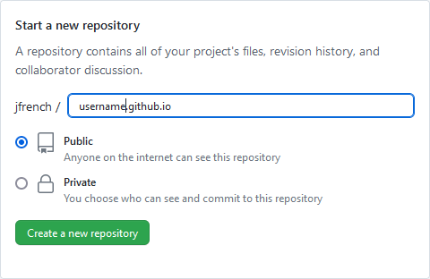
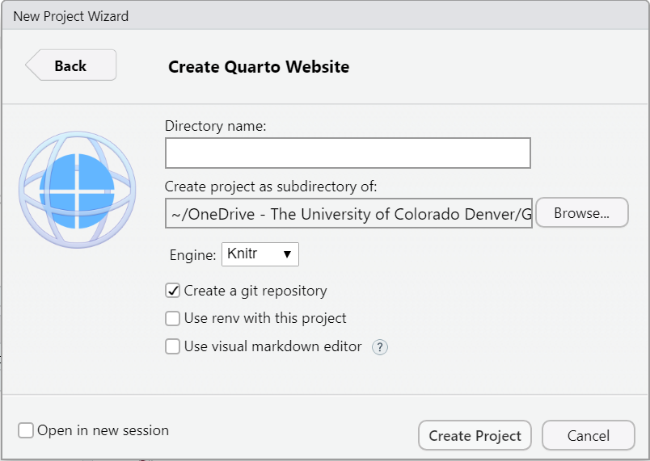
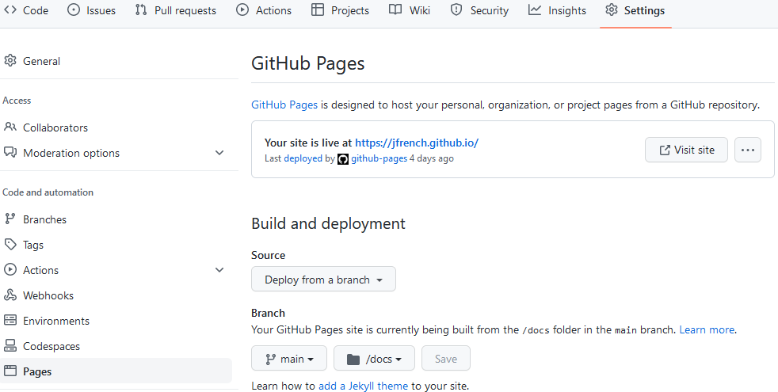
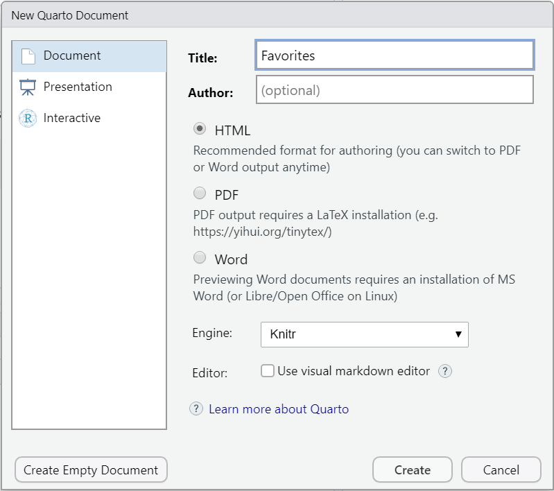

Many data scientists have a website to market themselves.
This is helpful for distinguishing yourself from competitors by showcasing who you are and what you've done.

It is very easy to create a personal webpage using Quarto websites and GitHub.
We will walk through the process of creating a very simple professional website that you can further customize to suit your own needs.

## What is git?

------------------------------------------------------------------------

{width="20%"}

Software developers need a fast, reliable way of tracking changes to their source code when working as individuals or as part of a team.

The best-in-class approach to software version control is git, which was created by Linus Torvalds in 2005 to improve on the version control applications available at the time.

From <https://git-scm.com/>:

> Git is a free and open source distributed version control system designed to handle everything from small to very large projects with speed and efficiency.

> Git allows and encourages you to have multiple local branches that can be entirely independent of each other. The creation, merging, and deletion of those lines of development takes seconds.

By default, git tracks files changed in a directory or repository locally, i.e., on our actual computer, which can create some potential challenges:

-   Git stores version history locally, but does not by itself provide a separate off-computer copy of your files. That could be problematic if your computer fails.
-   A centralized repository must be available when multiple contributors are working on the same project. There needs to be a way of easily managing each person's contributions and keeping track of the development and stable branches of the code.

GitHub provides one of the most popular solutions for these two issues.

## What is GitHub?

------------------------------------------------------------------------

{width="200"} {width="200"}

GitHub (<https://www.github.com>) is an online platform for hosting git repositories.
Additionally, it makes it easy to:

-   Control who is able to access and change a repository
-   Track bugs in our code
-   Keep record of feature requests
-   Delegate responsibilities
-   Maintain a wiki
-   etc.

GitHub is a great place to:

-   Backup and maintain version control of your software.
-   Make your software public and allow others to contribute and interact with your work.
-   Put project repositories to demonstrate your coding skills and abilities.
-   Host a professional website that advertises to potential employers or clients about how wonderful you are.

### Setting Up an Account in GitHub

------------------------------------------------------------------------

To begin this process:

-   From a web browser, go to <https://github.com/>.
-   **Sign in** if you already have a GitHub account.
-   Otherwise select **Sign up** and create a new account. It is FREE!


### Creating a GitHub Repository

----

From the main page, create a GitHub repository.
  
-   For your personal website, the repository name should be `username.github.io`. Obviously, replace `username` with your actual user name). @fig-create-username-github-io-repository displays an example of this.
-   For a project website, use the name of the project directory. I use "demosite" for the website we create in this module.
-   Select **Public** for the repository. GitHub Pages is available for public repositories with a free GitHub account.
-   Select **Add a README file** when creating the repository. This gives you an initial file in the repository and makes the browser-based upload steps below easier to follow.
-   Click **Create repository**.

You only need to create **one** repository for the website. A project website such as `demosite` is sufficient for this activity; you do not need to create a separate `username.github.io` repository.

{#fig-create-username-github-io-repository}


## What is Quarto?

------------------------------------------------------------------------

{height="200"}

The Quarto website (<https://quarto.org/docs/faq/>) states:

> Quarto is an open-source scientific and technical publishing system built on Pandoc.
> You can weave together narrative text and code to produce elegantly formatted output as documents, web pages, blog posts, books and more.

More helpfully, Quarto is the spiritual successor to R Markdown that was built from the ground up to be compatible with:

-   R
-   Python
-   Julia
-   Observable JavaScript.

Quarto's development is sponsored by Posit (<https://posit.co/>), which was formally known as RStudio.

{height="100"}

You can use Quarto to create:

-   Technical documents
-   Books
-   Blogs
-   Websites.

Quarto documents can be edited in:

-   RStudio/Posit Cloud
-   VS Code
-   JupyterLab
-   Any text editor.

RStudio (or Posit Cloud) provides the most feature-rich environment for creating Quarto documents.

To open a new Quarto document in RStudio:

1.  From the File menu click File → New File → Quarto Document.
2.  Make the appropriate changes.
3.  Click the Create button.

Click the Render button, {height="2em"}, to render the default Quarto document.


## Creating a Starter Quarto website

------------------------------------------------------------------------

The initial step to creating a Quarto website is to create a new Quarto website project.

### In RStudio

------------------------------------------------------------------------

1.  From the File menu, click File → New Project.

2.  Select New Directory → Quarto website.

3.  Choose a Directory name.

    -   Your GitHub-hosted personal website will have an address like `https://username.github.io`, while a website associated with a project will have the address `https://username.github.io/name`, where `username` is your GitHub username and `name` is the name of the GitHub repository for the website.
    -   If the hosted website will be `https://username.github.io`, then choose the directory name to be `username.github.io`.
    -   If the hosted website will be `https://username.github.io/name/`, then for simplicity, choose the directory name to be `name`.

4.  Choose where you want the directory to be located.

5.  Knitr is a suitable option for the rendering engine.

6.  Regarding the check boxes, I'd recommend

    -   The "Create a git repository" box is **optional if you will upload your files through the GitHub website**, as described in this module. You do not need local git or terminal commands to use that method. If you plan to use the optional terminal method in the appendix, you can check this box. If the box is missing and you intend to use git locally, see <https://git-scm.com/book/en/v2/Getting-Started-Installing-Git>. After installing git, restart RStudio.
    -   Uncheck the boxes next to "Use renv with this project". **renv** is a package for project-local R dependency management. Unless you're running completed R code on your webpages, then this isn't needed
    -   Uncheck "Use visual markdown editor". The visual markdown editor provides standard word processor like interface to your project. For me, this causes more problems than it solves, so I don't use this. You may have a different preference.

7.  Click "Create Project".

See @fig-project-options for an example of the project-creation options. The screenshot reflects an earlier workflow in which a local git repository was recommended; it is optional for the browser-based method used here.

{#fig-project-options}

### In Posit Cloud

------------------------------------------------------------------------

A Posit Cloud Project has been created that contains all of the files listed above.

1.  Go to <https://posit.cloud/content/10238221> to open the project named "Creating a Quarto Website".

2.  Copy the shared project into your own Posit Cloud account so you can edit and save changes to files.
    In the right side of the tool bar, select Save a Permanent Copy{height="2em"}

3.  In the main folder, there is a subfolder named `demosite` containing the files listed in the section below.

### What Files are Created?

------------------------------------------------------------------------

After clicking "Create Project", a new project will be created in the specified directory with the following files:

-   `_quarto.yml`: a YAML header that control certain aspects of the website like the main title of the site, the pages included in the site, and the theme (color scheme) of the site.
-   `.gitignore`: a file that contains files and directories that git isn't supposed to track.
-   `index.qmd`: the file that controls the default home page for your website.
-   `about.qmd`: a file that's supposed to add a page to your website with information about you. This is really an optional file.
-   `*.Rproj`: the R project file associated with your website. Open this to reopen your RStudio workspace.
-   `styles.css`: a file to create custom styles for use on your website.

The available files are enough to create an initial version of your website.

A complete description of available website options is available at <https://quarto.org/docs/reference/projects/websites.html>.

To host your Quarto website using GitHub pages, you will need to change the output directory of your project.
We discuss that next.

## Changing the Output Directory of a Quarto website

------------------------------------------------------------------------

The output directory is where Quarto saves the files for the rendered website.

To host your Quarto website using GitHub pages, it is best to change the output directory to "docs".

To change the output directory of your Quarto website:

-   Go to the `_quarto.yml` file
-   Add the line `output-dir: docs` under `type: website`

That part of your `_quarto.yml` file will look something like the code below.

```         
project:
  type: website
  output-dir: docs
```

When Quarto renders a website, it converts each .qmd page into an HTML file. For example, `index.qmd` becomes `index.html`, and `about.qmd` becomes `about.html`. The `_quarto.yml` file controls how these pages are organized into a website, including navigation, titles, and themes. Quarto also generates supporting files needed to display the website correctly.

::: {.callout-important}
**Rendering an individual `.qmd` file does not guarantee that changes to other pages have been rendered.** Before publishing your website, you should render the entire website so that all HTML files reflect your latest changes.
:::

## Rendering a Quarto Website

------------------------------------------------------------------------


GitHub Pages publishes the rendered files in the `docs` folder, not the `.qmd` files. Before uploading your website to GitHub, **render the entire website** to ensure all HTML pages reflect your latest changes.

### Rendering in RStudio Desktop

------------------------------------------------------------------------


1. Open your Quarto website project in RStudio.
2. In the **Build** tab, click **Render Website** (or **Render Project**, depending on your version).

This renders all `.qmd` pages and updates the `docs` folder.

### Rendering in Posit Cloud

------------------------------------------------------------------------


1. Open the **Terminal** tab, located next to the Console tab in the lower-left pane of Posit Cloud (directly below the Editor pane). If you don't see a Terminal tab, select **Tools → Terminal → New Terminal** from the menu.

2. Use the `cd` (**change directory**) command to navigate to the `demosite` folder containing your website files. Type the following command in the Terminal and press Enter:

   ```bash
   cd /cloud/project/demosite
   ```
   
3. To render the entire website, type the following command in the Terminal and press Enter.

   ```bash
   quarto render
   ```

**For both methods:** Verify that the `docs` folder contains `index.html`, `about.html`, and any other pages you created.

::: {.callout-important}
Whenever you finish editing your website and want to publish your changes to GitHub Pages, **render the entire website again before uploading the updated files**.
:::


## Publishing a Quarto Website on GitHub Pages

------------------------------------------------------------------------

GitHub Pages (<https://pages.github.com/>) is a feature of GitHub that allows you to host websites for you and your projects.

The websites are hosted directly from your GitHub repository, meaning that you can:

-   Keep a git repository of your website
-   Upload or push changes of your website to GitHub
-   See the changed website after GitHub Pages finishes publishing the update.

If your GitHub username is `username` and your website is contained in the `demosite` repository, then your rendered website will be `https://username.github.io/demosite/`.

-   The rendered website for this tutorial is available at <https://aspiegler.github.io/demosite>.
-   The rendered website for Adam's open education resource (OER) book on Statistical Theory is available at <https://aspiegler.github.io/Statistical-Theory/>.
-   The rendered website for Adam's open education resource (OER) book on Differential Equations (using Python) is available at <https://aspiegler.github.io/Exploring-Differential-Equations/>.
-   The rendered website for my in-progress open education resource (OER) book on linear regression is available at <https://jfrench.github.io/LinearRegression>.

If you are creating a personal website, then it is best to host it as `https://username.github.io`.

### Uploading and Updating Files Through the GitHub Website

------------------------------------------------------------------------

Now that you have rendered your entire Quarto website and verified that the docs folder contains the necessary files, you are ready to upload your website to GitHub.

There are different ways to manage the files in a GitHub repository. **For this module, we will use the GitHub website in a web browser.** You will not need to know any git terminal commands.

The steps below describe the **initial upload**, **updating files**, and **removing old files**. If you prefer to work with git from a terminal, see the appendix at the end of this document.

#### Step 1: Locate Your Website Files on Your Computer

------------------------------------------------------------------------

**If you are using RStudio installed on your own computer:** your Quarto project directory is already on your computer. Open the folder containing `_quarto.yml`.

**If you are using Posit Cloud:** after rendering the website, use the **Export** action for your Posit Cloud project to download the project as a `.zip` file. Extract (unzip) that file on your computer, and open the extracted project directory. For the provided Posit Cloud starter project, the website files are in the `demosite` subdirectory.

**Do not upload the `.zip` file itself to GitHub.** GitHub Pages needs the individual website files and folders.

#### Step 2: Upload the Files to Your GitHub Repository

------------------------------------------------------------------------

1.  In a web browser, sign in to <https://github.com/> and open the repository you created for your website.
2.  On the repository's main page, select **Add file → Upload files**. (If you created the repository with a README as instructed earlier, you should see an existing file and this menu.)
3.  Select the needed files **inside** your website's project directory and drag them into the upload area (or use **choose your files**). Include the files needed to edit the project, such as `_quarto.yml`, `index.qmd`, `about.qmd`, and `styles.css`, **and the entire `docs` folder** containing your rendered website. Also include any images or other files used by your pages. Do not drag the enclosing project folder itself.
    -   Preserve the folder structure: upload the contents of the project directory, **not another enclosing project folder**.
    -   Do not upload a `.zip` archive in place of the website files.
    -   If your computer shows hidden folders such as `.git` or `.Rproj.user`, you do not need to upload those folders. Likewise, temporary Quarto cache files are not needed to publish the site.
4.  Review the displayed file list and paths before finishing the upload. The important check is that the rendered homepage will be at `docs/index.html` in the repository, **not** `demosite/docs/index.html` (or some other extra nested directory).
5.  Under the commit options, enter a descriptive message such as `Initial website upload`. Select the option to **commit directly to the `main` branch** if it is available. Finish by selecting **Commit changes** (the wording may differ slightly in GitHub's interface).
6.  Return to the repository's main page and verify that your files are present. In particular, click `docs` and check that `index.html` is inside it.

GitHub places a limit on browser uploads of **100 files at once** and **25 MiB per individual file**. If your site has more than 100 files, you may need to upload the files in smaller batches while keeping their folder paths correct. This can happen with interactive graphics and large `site_libs` directories. See [GitHub's file-upload documentation](https://docs.github.com/en/repositories/working-with-files/managing-files/adding-a-file-to-a-repository).

For a project named `demosite`, the GitHub repository should resemble this:

```text
# Top level of your GitHub repository
_quarto.yml
index.qmd
about.qmd
styles.css
docs/
    index.html
    about.html
    site_libs/
    ... other rendered files ...
```

The `docs` directory may contain additional files and folders depending on the content of your website.

#### Step 3: Updating Files After Making Changes

------------------------------------------------------------------------

When you edit your website in RStudio or Posit Cloud, **the files in GitHub do not update automatically**. You must upload the updated files.

1.  Save your changes in RStudio and **render the entire website** again using **Build → Render Website**.
2.  If you are using Posit Cloud, export the revised project and unzip it on your computer again.
3.  In your GitHub repository, use **Add file → Upload files** and upload the revised files. Uploading a changed file with the same name **to the same path** replaces its previous version when you commit the change.
4.  Remember to upload the updated rendered files in `docs`, **not just the revised `.qmd` files**. If you changed the site title, navigation, stylesheet, or theme, several rendered files may need to be replaced.
5.  Enter a commit message such as `Update website`, commit directly to `main`, and check the website after GitHub Pages republishes it.

**For example:** Editing `index.qmd` locally but uploading only `index.qmd` to GitHub will not update the published homepage. GitHub Pages is serving `docs/index.html`, so that updated file must also be uploaded. The same applies to any changed support files in `docs`.

#### Step 4: Deleting Files You No Longer Need

------------------------------------------------------------------------

Uploading new files **does not automatically delete** files that you have removed from the project on your computer. If you delete `favorites.qmd` from your project, for example, its old copy may remain in GitHub until you also delete it there.

To delete an obsolete file using the GitHub website:

1.  Open your repository and navigate to the file you want to remove.
2.  Use the file's menu (often the `...` menu) and choose **Delete file**.
3.  Enter a commit message and commit the deletion to `main`.
4.  If the deleted page also has an old rendered HTML file (such as `docs/favorites.html`), delete that file from GitHub as well. If the page was linked from your navbar, update `_quarto.yml`, rerender, and upload the updated files.

Be careful not to delete the `docs` folder or its `index.html` file: GitHub Pages needs them for the publishing method used here.

#### A Quick Check Before Publishing or Updating

------------------------------------------------------------------------

-   Does the repository contain `_quarto.yml` and `index.qmd` at the top level?
-   Is the rendered homepage at **`docs/index.html`**, with no extra enclosing folder?
-   Have you uploaded the **current rendered files** from `docs`, including supporting assets?
-   Have you **committed** your uploads or deletions to the `main` branch?
-   If something isn't displaying properly, have you compared the repository's files with the files in your most recently rendered `docs` folder?

### Publishing to GitHub Pages

------------------------------------------------------------------------

-   On <https://GitHub.com>, navigate to your website's repository.
-   Click on the Settings button, {height="2em"}.
-   On the Navigation bar, click "Pages".
-   Under **Build and deployment**, set **Source** to **Deploy from a branch**.
-   Set **Branch** to `main` and **Folder** to `/docs`, then click **Save**. @fig-github-pages demonstrates the folder selection in an older version of the GitHub interface. The current page may look somewhat different.
-   Before publishing, GitHub Pages should find `index.html` at the top level of the selected `/docs` folder. If it is instead under another subfolder, return to the file-upload instructions above and correct the directory structure.

{#fig-github-pages}

**After GitHub Pages finishes deploying**, you should see the initial version of your website at `https://username.github.io` or `https://username.github.io/name` depending on the type of site you created. GitHub indicates that publishing or updating a site can take up to about 10 minutes. You can find the website's actual address and the **Visit site** link under **Settings → Pages**.

**Disable Jekyll processing:** GitHub Pages normally uses Jekyll when publishing from a branch. Quarto produces the HTML for us, so we do not need Jekyll to rebuild it. Create an empty file named `.nojekyll` in the root of the publishing source (`docs`) using **Add file → Create new file** while inside the `docs` folder in GitHub. If GitHub requires text in the file to permit committing it, a short note is harmless: GitHub checks for the file's presence. Commit this file to `main`. The [GitHub Pages documentation](https://docs.github.com/en/pages/getting-started-with-github-pages/creating-a-github-pages-site) explains the `.nojekyll` convention.

If the website does not appear or does not show your recent changes, check that the repository is public, GitHub Pages is configured for **`main` / `/docs`**, `docs/index.html` exists, and the latest files were committed to `main`. You can also try refreshing the published page after the deployment finishes.

## Changing the Main Title of a Quarto website

------------------------------------------------------------------------

The main title of a Quarto website is controlled through the `_quarto.yml` file.

Specifically, find the section of `_quarto.yml` where it has:

```         
website:
  title: "demosite"
```

Change "demosite" (or whatever title you have) to whatever you wish.
For your personal website, it makes sense to use something like:

-   "First name Last name", e.g., Langston Hughes"
-   "First name Middle initial Last name", e.g., Amy R. Tan"
-   Your brand identity, e.g., "Assistant to the Regional Data Manager"

Change the title to something you prefer and save your changes.

Next, **render the entire website** using **Build → Render Website** in RStudio Desktop or the `quarto render` command in Posit Cloud, as described earlier.

Then **upload all the website files and folders** to your GitHub repository, preserving the directory structure, even if some files have not changed. Remember to commit your changes. If using Posit Cloud, you will first need to export and unzip the updated project.

Finally, refresh your published website to verify that the new title appears.

## Adding or Removing a Page from a Quarto Website

------------------------------------------------------------------------

Pages can easily be added or removed from a Quarto website.

To add a new page to your website, add a new Quarto document to your project folder:

-   Click File → New File → Quarto Document ...
-   Enter the desired page Title in the Title box of the New Quarto Document window.
-   Click the Create Empty Document button in the lower left corner of the window.
-   Press `Ctrl + s` (Windows) or `Cmd + s` (Mac) to bring up the Save File window.
-   Name your file and click the Save button.

@fig-new-quarto-document displays the New Quarto Document window you would have to create a new Quarto document with the title "Favorites".

{#fig-new-quarto-document}

@fig-save-quarto-dialog shows the Save File window you would use to create `favorites.qmd`.

{#fig-save-quarto-dialog}

Now you can add the desired content to your new Quarto document.
We will add the following text to `favorites.qmd`.

```         
## Favorite dog breeds

- Greater Swiss Mountain Dog
- Chocolate Labrador Retriever
- Any mixed breed!

## Favorite characters from the Lord of the Rings movies

- Samwise Gamgee
- Gimli
- Gollum
```

To add the "Favorites" page to our website, we open the `_quarto.yml` file and navigate to the `navbar` section where `.qmd` files are listed are a dash.
We add a new row with `- favorites.qmd` as in the code below.

```         
  navbar:
    left:
      - href: index.qmd
        text: Home
      - about.qmd
      - favorites.qmd
```

To remove a page from your Quarto website, simply delete its line from the `navbar` section.
Keep the `index.qmd` **file**, since it provides the homepage. You can remove its navbar row if you do not want a separate Home link in the navigation bar.

Render the entire website to preview your changes. In RStudio Desktop, select **Build → Render Website**. In Posit Cloud, run `quarto render` from the Terminal in your website project directory.

## Changing the Color and Style Theme of a Quarto Website

------------------------------------------------------------------------

Themes can be used to change the default color and style themes of a Quarto website.

Quarto provides over 20 themes "out of the box" from [Bootswatch.com](https://bootswatch.com/).
Some of my favorite themes include:

-   journal
-   lux
-   quartz
-   simplex
-   spacelab

A complete list of themes is available at <https://quarto.org/docs/output-formats/html-themes.html#overview>.

To get a taste of theme customization, let's change the theme of a Quarto website to "sandstone".
We update the `theme` option of the `_quarto.yml` file to `sandstone` using the code below.

```         
format:
  html:
    theme: sandstone
```

Theme options can be used to customize a theme and set the default choice for the entire document.
These include:

-   `mainfont`: the default font-family
-   `fontsize`: the default font-size
-   `fontcolor`: the default text color
-   `linkcolor`: the default color for hyperlinks
-   `monofont`: the default font-family for code
-   `backgroundcolor`: the default background color for the entire document.

A more detailed discussion of theme customization can be found at <https://quarto.org/docs/output-formats/html-themes.html>.

Quarto font sizes can be specified using many different units.

-   Absolute units like pt, cm, mm, in, pc, etc. are not recommended.
-   Relative units like em or rem are better.
    -   1em is equivalent to the default font size for body text. So 3em is 3 times as big as the body font.
    -   rem, which stands for root em, is the font size of the root element of the document, which is consistent throughout the document.

Quarto website colors are specified in hexadecimal format.

-   The website <https://htmlcolorcodes.com/> is a handy tool for determining hexadecimal values to make font or background color changes.
-   Place quotes around the hexadecimal values when you use them to change a color in your document.

We now customize:

-   The main font of the website
-   The standard font size
-   The standard font color
-   The color of hyperlinks
-   The font used for code.

by editing the appropriate section of `_quarto.yml`.

```         
    theme: sandstone
    mainfont: arial
    fontsize: 1.5rem
    fontcolor: "#0013d5"
    linkcolor: "#ff33f0"
    monofont: courier new
```

Render the entire website to preview your changes. In RStudio Desktop, select **Build → Render Website**. In Posit Cloud, run `quarto render` from the Terminal in your website project directory.

## Using a Quarto Website "about" Template

------------------------------------------------------------------------

While Quarto is naturally great for building technical documents, on the surface, it is not great for building a snazzy website.

An about template can be used to create a page with a specific default structure.
These templates are designed to look great by default and to help website visitors learn "about" you.

Each page in a Quarto website is rendered from `qmd` files you place in the project directory.

-   Using an about template will change the page's structure.
-   An about template is specified in the YAML header of the `.qmd` file you want to customize.

Currently, Quarto has 5 built in templates that are discussed in more detail at <https://quarto.org/docs/websites/website-about.html#templates>.

The current templates are:

-   `jolla`
-   `trestles`
-   `solana`
-   `marquee`
-   `broadside`

A preview of each template is available at <https://quarto.org/docs/websites/website-about.html#templates>.

Each template allows you to add the following elements:

-   `image`: an image you want to display on the page. This could be a picture of yourself or something else you want the page to display. You can customize the image in two ways:
    -   `image-width`: A valid CSS width for your image.
    -   `image-shape`: The shape of the image.
        -   The shape options are: `rectangle`, `rounded`, `round`.
        -   Shape options are only available for the jolla, solana, and trestles templates.
-   `links`: links you want to provide for the user to click on. These could be links to your GitHub page, email address, Twitch account etc. The links have the following options:
    -   `href`: a link to a file contained with the project or an external URL.
    -   `text`: the text to display for the link (if not provided, the default is the document title).
    -   `icon`: the name of one of the standard Bootstrap 5 icons (e.g. "envelope", "github", "twitter", "youtube", etc.). A current list of icons is available at <https://icons.getbootstrap.com/>.
    -   `aria-label`: accessible label for the navigation item.
-   Partial page content: this is text on your page that doesn't have the same formatting as the rest of the template.
    -   Specify the `id` option under `about` to indicate the keyword to start the partial page content.
    -   Include the desired partial page content between `:::{#id-name}` and `:::`, where `id-name` is the name specified for the `id` option.

Personally, I like to use an about template on the home page of my website, not on a separate "About" page.
Obviously, that is up to you.

You will need to add three files to your project directory to complete the example below.
You can:

-   Manually download the files from my GitHub page at <https://github.com/CU-Denver-MathStats-OER/Data-Wrangling-and-Visualization/tree/main/Images>.
-   Download the files by directly clicking the file names below.

Go to the [Images directory in our course GitHub repository ](https://github.com/CU-Denver-MathStats-OER/Data-Wrangling-and-Visualization/tree/main/Images) and download and then upload the following three files to your **project directory**:

-   [`mypic.png`](https://raw.githubusercontent.com/CU-Denver-MathStats-OER/Data-Wrangling-and-Visualization/main/Images/mypic.png)
-   [`dawgs.png`](https://raw.githubusercontent.com/CU-Denver-MathStats-OER/Data-Wrangling-and-Visualization/main/Images/dawgs.png)
-   [`resume.pdf`](https://raw.githubusercontent.com/CU-Denver-MathStats-OER/Data-Wrangling-and-Visualization/main/Images/resume.pdf)


### Using the about Template and Adding an Image and Title

------------------------------------------------------------------------

To use an about template, we must change the YAML header of our file.
We will do this for `index.qmd`, the main page of our website.

We will replace the YAML header of `index.qmd` with code that will:

-   Use the "jolla" template
-   Use a round image ("mypic.png")
-   Add the title "A. Data Wrangler" on the page

```         
---
title: "A. Data Wrangler"
image: mypic.png
about:
  template: jolla
  image-shape: round
  image-width: 15em
---
```

### Adding Links to an about Template

------------------------------------------------------------------------

Next we discuss add URL and file links to our about template.

We add the following rows under the `about` section of our YAML header, which will add clickable links for an email address, a GitHub page, a YouTube page, and a file, as well as icons for each link.

```         
  links:
    - text: Email
      icon: envelope
      href: mailto:noreply@email.zz
    - text: GitHub
      icon: github
      href: https://github.com/
    - text: YouTube
      icon: youtube
      href: https://youtube.com/
    - text: resume
      icon: file-text
      href: resume.pdf
```

### Adding Partial Page Content to an about Template

------------------------------------------------------------------------

To add partial page content to our about template, we must:

1.  Indicate an id in the YAML header of the page.
2.  Add the partial page content below the header.

We add the following id for our partial page content:

```         
  id: ppc
```

Then, below our YAML header, we add some content about dogs and why someone should hire us.

```         
:::{#ppc}
I love my dogs. Here is a picture of my dogs.


If you like dogs too, then you should definitely hire me for
a highly paid position.
:::
```

Render the entire website to preview your changes. In RStudio Desktop, select **Build → Render Website**. In Posit Cloud, run `quarto render` from the Terminal in your website project directory.

## Fixing a Broken File Link on a Quarto Website

------------------------------------------------------------------------

Linking to a file in a Quarto website is slightly more complicated than linking to a URL.

Notice that `resume.pdf` on the demosite isn't available.
It isn't available because it is not in the docs folder used to render the website.
(You can verify this by navigating to the docs older in the Files pane of RStudio).
There are two options to correct this:

1.  Manually copy `resume.pdf` to the docs folder. Don't do this.
2.  Add the line `resources: resume.pdf` to your YAML header. This tells Quarto to copy this file to your docs folder when rendering the website. This is the best approach.

In the code below, we wedge `resources: resume.pdf` between the `image` and `about` options.

```         
image: mypic.png
resources: resume.pdf
about:
```

Render the entire website to preview your changes. In RStudio Desktop, select **Build → Render Website**. In Posit Cloud, run `quarto render` from the Terminal in your website project directory.


## Publishing Your Updated Website to GitHub

------------------------------------------------------------------------

Once your website looks the way you want locally, you're ready to publish the updated version to GitHub Pages.

1. **Render the entire website** to ensure all HTML files reflect your latest changes.

2. **Upload all website files and folders** to your GitHub repository using the browser-based drag-and-drop method described earlier. This includes your `.qmd` files, `_quarto.yml`, the entire `docs` folder, and any other files used by your website (such as images or `styles.css`). Preserve the directory structure, even for files that haven't changed. If using Posit Cloud, first export and unzip the updated project.

3. **Commit your changes** to save the updates to your GitHub repository.

4. **Refresh your published website** after GitHub Pages finishes deploying the changes. Your public website should now match the version you created locally.

::: {.callout-important}
Upload the **contents** of your Quarto website project folder, not the enclosing folder itself. The `_quarto.yml` file and `docs` folder should be at the top level of your GitHub repository.
:::

## Appendix: Managing the Repository with Git Terminal Commands (Optional)

------------------------------------------------------------------------

The main instructions above use GitHub in a web browser. This appendix is an alternative for students who already use git or would like to learn the terminal method. Do **not** mix browser uploads and local `git push` operations without first syncing changes; otherwise your local and remote versions may differ.

### Verfiying and/or Installing git

------------------------------------------------------------------------

[See instructions](https://github.com/git-guides/install-git) for checking if you already have git installed or how to install git if you don't.


### Connecting a Local Git Repository to GitHub

------------------------------------------------------------------------

Open a terminal in your Quarto project directory. **The example commands below assume the GitHub repository was created without a README or other initial files.** If you followed the main instructions and created the GitHub repository with a README, it is better to clone that existing repository first and place your website project files in the cloned directory instead of starting a separate local history. If you checked **Create a git repository** when creating the RStudio project, you can skip `git init` because it has already been initialized. Otherwise run it once. Replace `USERNAME` and `REPOSITORY` with your actual GitHub username and website repository name.

```bash
git init
git add -A
git commit -m "Initial website upload"
git branch -M main
git remote add origin https://github.com/USERNAME/REPOSITORY.git
git push -u origin main
```

If the remote repository was initialized with a README before your local repository was connected to it, these histories will not be identical. Rather than forcing a push, follow an established Git workflow to reconcile them or continue using the browser method in the main instructions. GitHub authentication is also required for HTTPS pushes; a GitHub account password alone will not work. See [GitHub's authentication guidance](https://docs.github.com/en/authentication/keeping-your-account-and-data-secure/about-authentication-to-github).

### Sending Subsequent Updates

------------------------------------------------------------------------

After saving changes and rendering the entire site, use these commands in the project directory:

```bash
git add -A
git commit -m "Update website"
git push
```

`git add -A` includes newly created files, modifications, and deletions. This is more reliable than using `git commit -am`, which does not stage new files.

If changes were made on GitHub or another computer, first fetch and incorporate the remote changes before pushing again:

```bash
git pull
```

The command `git status` is helpful for seeing what has changed and which files have not yet been committed. If you use Posit Cloud and want to sync git directly from there rather than exporting files, see the [Posit Cloud documentation](https://docs.posit.co/cloud/guide/advanced/#working-with-github).
